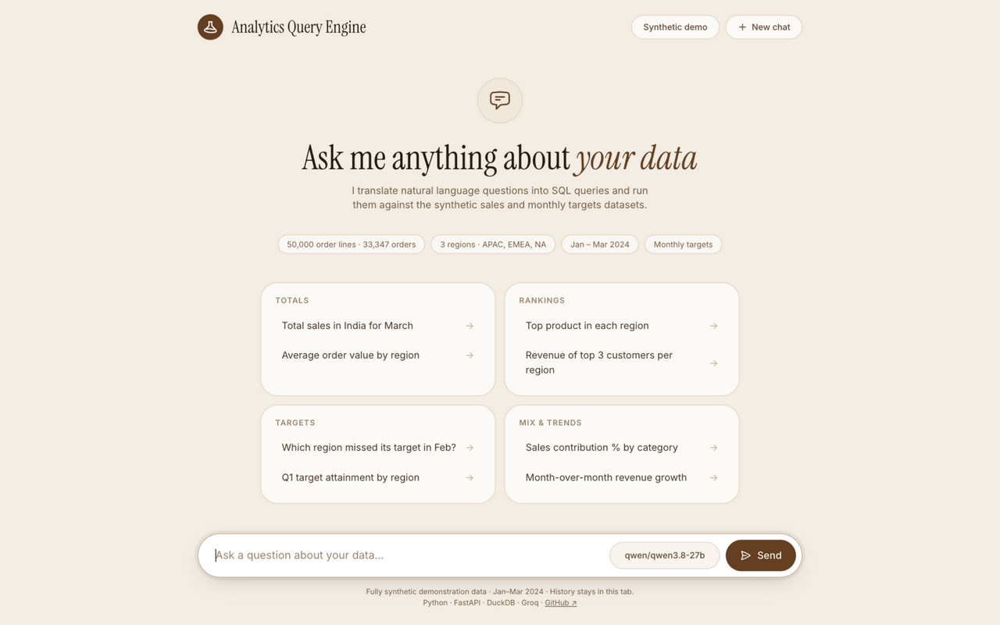
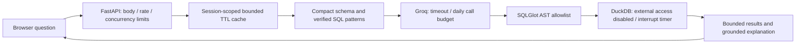

# Analytics Query Engine

Ask a business question in plain language, inspect the generated SQL, and explore the answer. The Analytics Query Engine combines Groq with a restricted DuckDB executor and a lightweight, accessible HTML/CSS/JavaScript interface.

**Live demo:** deployment pending — add the Render URL here after verification.

> This application uses a fully synthetic demonstration dataset. No real customer or company sales data is used.



The screenshot is from the running local interface. [Target comparison screenshot](docs/screenshots/analytics-targets.png) uses an explicitly mocked model response and real DuckDB results; it is not evidence of live model accuracy.

## What it does

- Converts natural-language questions into SQL using a configurable Groq model.
- Answers revenue, profit, product, customer, and monthly target questions.
- Shows reproducible SQL, result tables, deterministic explanations, timings, and CSV export.
- Enforces SQL, request, result-size, concurrency, and AI budget limits on the server.
- A floating glass panel shows the last six chats; “+” opens a searchable history of up to 30 conversations. History stays in this browser tab, and opening a saved chat makes no AI request. Feedback uses temporary session-bound receipts.
- Preserves the original interface, warm palette, typography and chat controls alongside the Python / FastAPI / DuckDB / Groq architecture. Fonts, compiled styles and SQL libraries are served locally; no frontend framework or runtime CDN is required.

Try “What is the total revenue?”, “Which region generated the most revenue?”, “What is the average order value?”, or “How does revenue compare with monthly targets?” Model generation can still be wrong; inspect its SQL.

## Dataset

| Property | Validated value |
|---|---|
| Order lines / distinct orders | 50,000 / 33,347 |
| Distinct customers / repeat customers | 8,424 / 6,584 |
| Coverage | January 1–March 31, 2024 |
| Regions | APAC, EMEA, NA |
| Monthly regional targets | 9 |
| Total revenue | 23,341,186.3890 dataset currency units |
| Total supplied profit | 3,090,849.13 dataset currency units |

Revenue is `quantity * unit_price * (1 - discount)`; discounts are fractions. Orders and repeat customers use distinct order IDs. Profit is the supplied line value; shipping is a separate line value whose relation to profit is undocumented, so the app does not subtract it again. Currency is unspecified. Target joins aggregate sales by region and month first. There is no historical baseline for year-over-year analysis.

The attached CSV bytes are preserved in `data/`. Original small inputs are archived in `data/archive/original/`. On startup, the app validates and loads source CSVs directly into memory; existing processed files cannot override them. Restart after changing the source snapshot. Optional preprocessing refreshes derived outputs using source and output hashes.

## Run locally

Python 3.10+ and [uv](https://docs.astral.sh/uv/) are required.

```bash
uv sync --no-group evaluation
cp .env.example .env
# Set GROQ_API_KEY in your local .env, or export it in your shell.
uv run python main.py
```

Open <http://localhost:8000>. Without a key, the interface and health check still work; AI questions return a clear HTTP 503. Visitors never need to supply a key. `.env` is ignored and no longer tracked; the local file is preserved. Rotate the credential previously committed at `70bd7526d933:.env` before publishing. History was not rewritten.

`GROQ_API_KEY` takes precedence. A non-placeholder `GROQ_API_KEY_2` remains a deprecated fallback for existing local configurations. The public demo rejects keys submitted in API bodies. Advanced local API clients can still use a request-specific key when `DEMO_MODE=false`.

The default is `openai/gpt-oss-120b`; `openai/gpt-oss-20b` and `qwen/qwen3.8-27b` are selectable. Availability was checked against [Groq's model documentation](https://console.groq.com/docs/models); account access and quotas still require a live check. No automatic provider/model fallback occurs.

## Architecture



Source data is loaded once per process. SQL must be a single analytical SELECT over approved tables, columns bound by DuckDB, and allowlisted functions. CTEs, joins, aggregates, dates, HAVING, and windows remain supported. The database disables external access and locks configuration after loading. Query execution is serialized to make timer interruption safe. Model and database work run outside the API event loop.

## Configuration

See [.env.example](.env.example) for every supported threshold.

| Variable | Default |
|---|---:|
| `GROQ_API_KEY` | empty; set server-side |
| `GROQ_MODEL` | `openai/gpt-oss-120b` |
| `DEMO_MODE` / `APP_ENV` / `LOG_LEVEL` | `true` / `development` / `info` |
| `CLIENT_REQUESTS_PER_MINUTE` / `GLOBAL_REQUESTS_PER_MINUTE` | 5 / 30 |
| `MAX_CONCURRENT_REQUESTS` | 2 |
| `LLM_DAILY_REQUEST_BUDGET` | 200 provider calls; UTC reset |
| `MAX_SELF_CORRECT_ATTEMPTS` | 2 total calls, including retries |
| `GROQ_TIMEOUT_SECONDS` / `SQL_TIMEOUT_SECONDS` | 20 / 3 |
| `MAX_RESULT_ROWS` / `DUCKDB_MEMORY_MB` | 200 / 192 |
| `PORT` / `TRUSTED_PROXY_IPS` | 8000 / empty |

API bodies are limited to 8 KiB, questions to 1,000 characters, results to 128 KiB / 40 columns, and cached responses to 64 entries of 128 KiB for 15 minutes. Excessive rows produce a request-to-narrow error rather than silently changing analytical aggregates. The browser renders at most 200 rows per answer and ten answers per conversation. Its session-only chat library retains up to 30 conversations, bounded to 2 MiB, with the six most recent shown in the glass panel. “New chat” preserves previous conversations in that tab; closing the tab clears the library.

## API

| Route | Behavior |
|---|---|
| `POST /api/query` | `{ "query": "What is the total revenue?", "model": "openai/gpt-oss-120b" }` |
| `GET /api/models` | Supported model IDs, default, synthetic scope |
| `GET /healthz` | Readiness and loaded row count; no credentials |
| `POST /api/feedback` | `{ "feedback_id": "receipt from query response", "feedback": "positive" }`; session cookie required |
| `GET /api/history` | HTTP 410; server history is not public |

Errors use appropriate 413, 422, 429, 503, or generic 500 responses. Raw provider exceptions and stack traces are not returned. API documentation is disabled in demo mode.

## Tests and evaluation

```bash
uv run --no-group evaluation python -m unittest discover -s tests -p 'test_*.py' -v
uv run python -m scripts.validate_data
uv run python -m scripts.preprocess
uv run --no-group evaluation python -m scripts.benchmark --runs 5
```

The standard suite needs no key and makes no provider requests. It tests the full dataset, decimal revenue, target joins, stale preprocessing, SQL attacks, actual interruption, provider failures, privacy, limits, cache invalidation, and concurrency. [Evaluation methodology and measured results](docs/EVALUATION_CURRENT.md) distinguish local SQL and mocked API measurements from live generation accuracy. [Historical evaluation](docs/EVALUATION_TRACE.md) describes the old dataset only and is not a current accuracy claim.

Optional live evaluation makes provider calls and respects the demo's request limit:

```bash
uv run python -m tests.eval.run_groq_eval --ids T1.1 T2.3
# Optional external judge; uses an additional provider and quota:
uv sync --group evaluation
uv run --group evaluation python -m tests.eval.run_eval
```

The Gemini judge is retained as optional developer tooling and excluded from deployment dependencies. No live evaluation was run for this implementation.

## Deploy and limitations

Use the bundled [Render blueprint](render.yaml) or follow [the exact manual setup](docs/DEPLOYMENT_RENDER.md). Review the [implementation report](IMPLEMENTATION_REPORT.md) before publishing.

One process and one instance are required for the in-memory limits. Daily request counts are not token or monetary budgets and reset on process restarts, including Render cold starts. Configure provider-side quotas too. Proxy headers are ignored by default; visitors may share a rate bucket behind Render's ingress. Trust only verified proxy IP ranges, never arbitrary forwarding headers or `*`.

DuckDB's memory setting does not cap the entire Python process. Interrupts work for the tested queries but cannot make embedded native code a hard OS sandbox. Local benchmarks do not establish performance on Render's smaller CPU. Render Free sleeps after idle periods and loses local changes on restart; see [its current limits](https://render.com/docs/free). Live model quality, deployment, and physical-device checks remain manual steps. The responsive layout was checked in a real 388-pixel browser frame; the preview viewport-resize tool timed out. Confidence is model-reported and uncalibrated. The app is a portfolio demonstration, not a production multi-tenant service.
