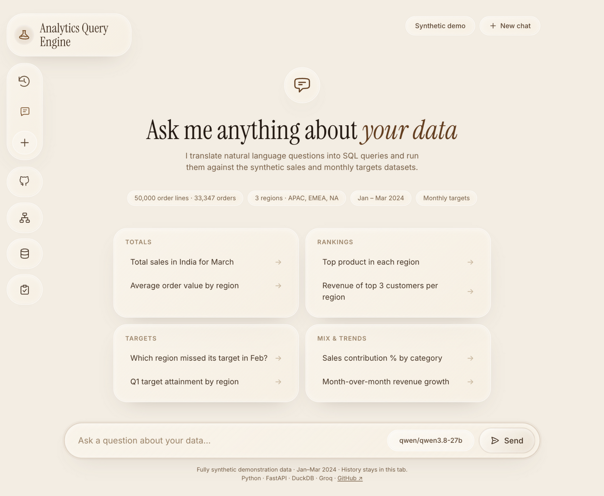
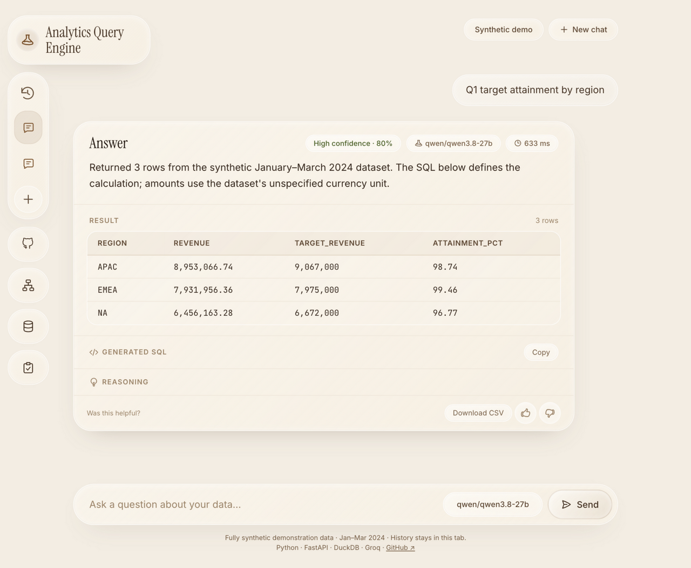
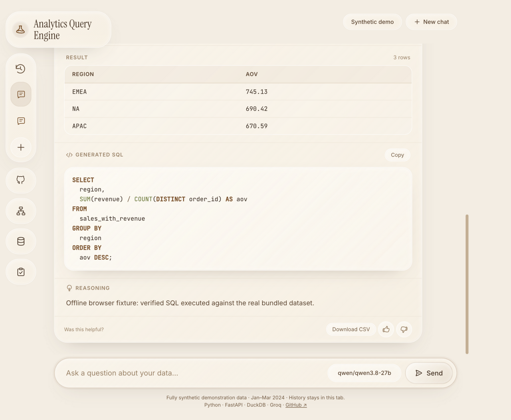
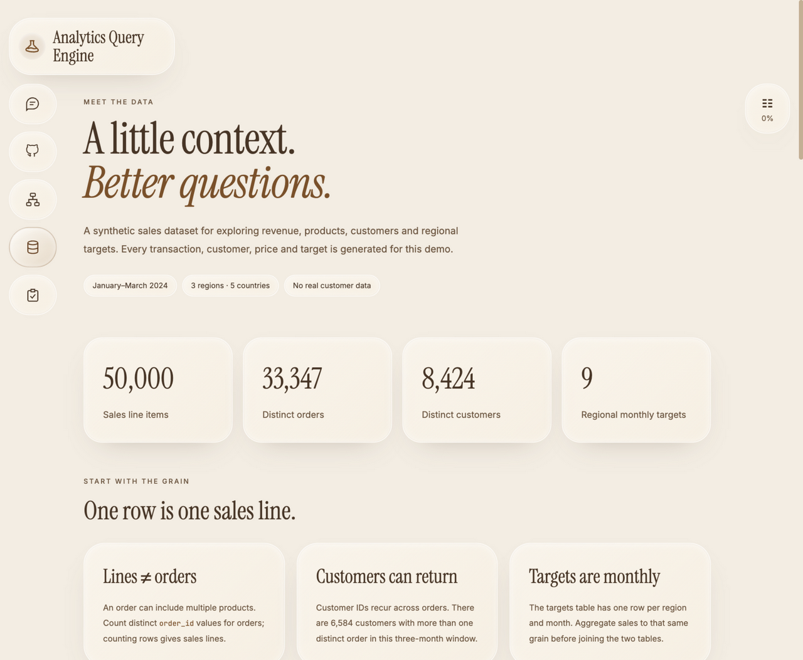
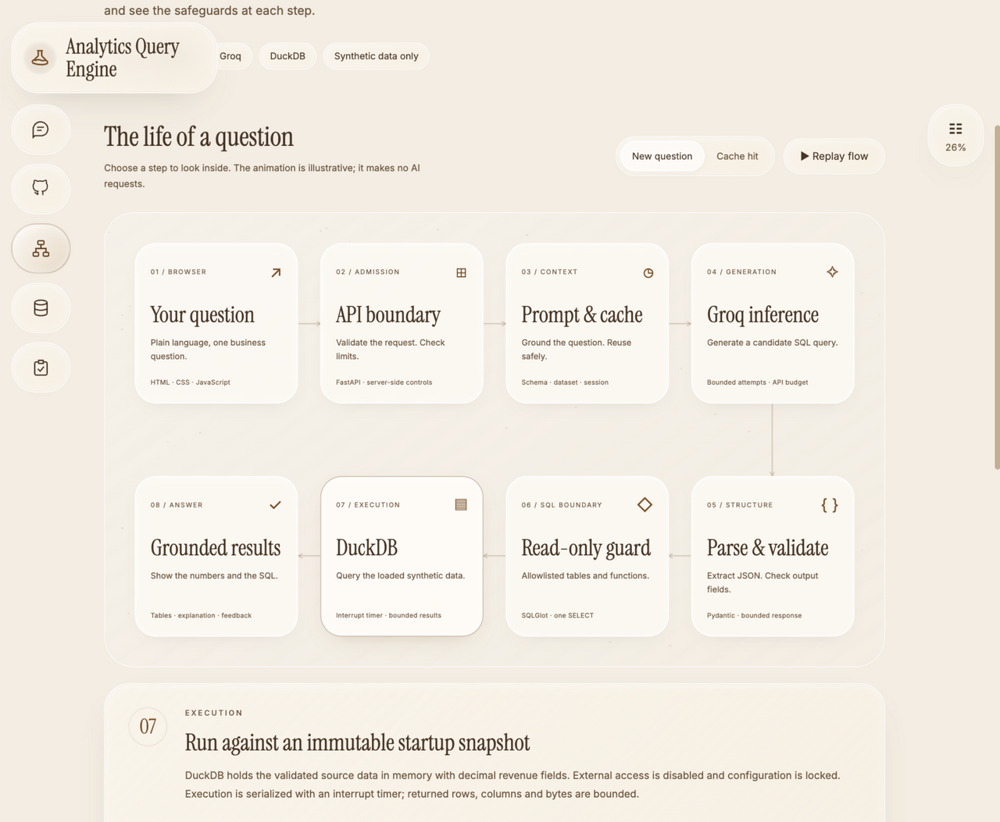
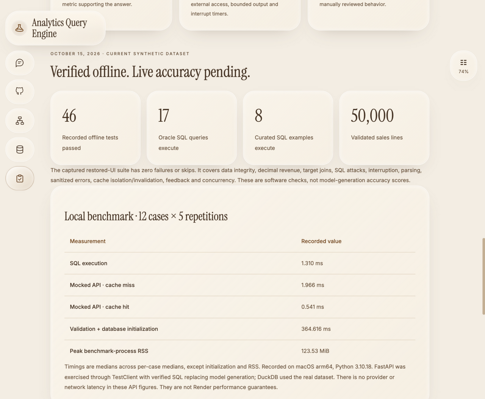
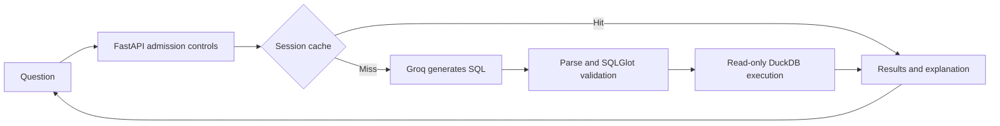

# Analytics Query Engine

**Ask in plain language. Inspect the SQL. Verify the answer.**

A natural-language analytics workspace built with FastAPI, Groq and DuckDB. Explore synthetic sales data through a chat interface with transparent calculations, bounded query execution and session-scoped caching.

[Interface tour](#interface-tour) · [Quick start](#quick-start) · [Dataset](#dataset) · [Evaluation](#evaluation) · [Deploy](#deploy-on-render)



*The current workspace: suggested business questions, model selection and recent conversations in a warm glass interface.*

## What you can do

- **Ask business questions:** revenue, products, customers, margins and monthly targets.
- **Inspect the calculation:** generated SQL, result tables, grounded explanations, timings and CSV export.
- **Continue a conversation:** six recent chats in the floating glass sidebar; searchable history stored in the current browser tab.
- **Understand the system:** dedicated Data, Architecture and Evaluations pages, with traceable methodology and evidence.
- **Choose a model:** GPT-OSS 120B, GPT-OSS 20B or Qwen 3.8 27B through Groq. Model access depends on your account.

The frontend uses HTML, CSS and JavaScript with local fonts and libraries. No frontend framework, runtime CDN or separate frontend build server is required.

## Interface tour

### From a question to a verifiable answer

Ask a question, choose a model, and inspect a structured result. Each response exposes its SQL, explanation, confidence and processing time, with CSV export and feedback controls. Repeated questions can use a session-scoped cache.



*Example: Q1 target attainment by region. Revenue and target totals come from the bundled synthetic dataset.*

### Inspect the SQL and reasoning

Expand **Generated SQL** to see the formatted, highlighted query and copy it for review. The **Reasoning** panel records the calculation logic returned with the query; it is not a hidden model chain of thought.



*Screenshot provenance: query demonstrations use the explicit offline browser fixture with predetermined SQL and real DuckDB execution. The displayed model, confidence and timings are fixture metadata—not measurements of live model inference. [Capture notes](docs/screenshots/current/capture-notes.json).*

### Explore the data, system and evidence

The sidebar connects the workspace with three reference pages. A contents menu tracks reading progress and supports section jumps.

<details>
<summary><strong>Data — fields, business definitions and coverage</strong></summary>

Understand the 50,000-line dataset, regional monthly targets, revenue calculations and limits before interpreting an answer.



</details>

<details>
<summary><strong>Architecture — follow the inference and execution path</strong></summary>

Explore the eight-stage flow from question to grounded result. Select a stage, pause playback, or switch to the cache-hit path. The animation is illustrative and makes no provider calls.



</details>

<details>
<summary><strong>Evaluations — inspect recorded results and their limits</strong></summary>

Review the historical model campaign, known failures, current offline checks and source artifacts. Historical scores and mocked API benchmarks are labeled separately from live model accuracy.



</details>

## Quick start

Requires **Python 3.10+** and [uv](https://docs.astral.sh/uv/).

```bash
git clone https://github.com/manyakaistha/nl-analytics-query-engine-.git
cd nl-analytics-query-engine-
uv sync --no-group evaluation
cp .env.example .env
```

Set `GROQ_API_KEY` in `.env`, then start the app:

```bash
uv run --no-group evaluation python main.py
```

Open **http://localhost:8000**. Try:

> Which region missed its target in February?

The interface and `/healthz` work without a key; AI queries require one. Keep the key server-side. Visitors do not supply credentials. Review the credential rotation note in [the deployment guide](docs/DEPLOYMENT_RENDER.md) before publishing.

## Dataset

All customers, transactions, prices and targets are **synthetic**.

| Scope | Value |
|---|---|
| Sales line items | 50,000 |
| Distinct orders / customers | 33,347 / 8,424 |
| Coverage | January–March 2024 |
| Regions | APAC, EMEA, NA |
| Monthly regional targets | 9 |

Revenue is `quantity × unit_price × (1 − discount)`. Count distinct order IDs for orders; aggregate sales by region and month before joining targets. Currency is unspecified. Supplied profit is summed directly; shipping is not subtracted again.

Source CSVs are validated and loaded into memory at startup. Restart after changing the snapshot. These three months do not support year-over-year, churn or lifetime-value conclusions.

**In the running app:** [About the data](http://localhost:8000/static/data.html) · **Source:** [dataset summary](data/DATASET_SUMMARY.json)

## How it works



The prompt supplies schema, metric rules, dataset facts and reviewed SQL examples. SQL must pass a single-query, table and function allowlist before execution. DuckDB disables external access and uses an interrupt timer; results, retries, request rates and concurrent work are bounded.

The cache includes session, model, prompt and dataset identity. Repeated equivalent questions reuse the saved result; opening chat history makes no model request. History stays in browser session storage, while feedback uses expiring session-bound receipts.

**In the running app:** [Interactive architecture](http://localhost:8000/static/architecture.html)

## Evaluation

The repository separates **historical model behavior** from **current offline software checks**.

| Evidence | Recorded result | Scope |
|---|---|---|
| Complete historical GPT-OSS 120B run | 15/17 exact oracle shapes; 11/13 behavior passes | Original 10-order dataset; one run per question; behavior manually reviewed |
| Current offline regression suite | 46 passed, no failures or skips | Current 50,000-line dataset; no provider calls |
| Current SQL validation | 17 oracle queries and 8 curated examples execute | Validates reference SQL, not model generation |
| Local benchmark | 1.310 ms SQL; 1.966 ms mocked API miss; 0.541 ms hit | Median across case medians, 12 cases × 5 runs; macOS arm64; mocked generation |

**Current live text-to-SQL accuracy and Render latency remain unmeasured.** There is no completed comparison of all three selectable models. Historical results cannot establish current accuracy or a winning model; exact output shape and manual behavior judgments measure different things.

- [Current evaluation and benchmark artifacts](docs/EVALUATION_CURRENT.md)
- [Historical campaign, failures and improvements](docs/EVALUATION_TRACE.md)
- [Complete historical case review](tests/eval/traces/2026-09-23T10-30_groq/combined_review.md)
- [Question catalog and SQL oracles](tests/eval/queries.yaml)
- **In the running app:** [Evaluations](http://localhost:8000/static/evaluations.html)

Run offline checks:

```bash
uv run --no-group evaluation python -m unittest discover -s tests -p 'test_*.py' -v
uv run --no-group evaluation python -m scripts.validate_data
uv run --no-group evaluation python -m scripts.benchmark --runs 5
```

For an intentional live sample, start the app with a valid key, then run `uv run python -m tests.eval.run_groq_eval --ids T1.1 T2.3`. This consumes provider quota. The optional Gemini judge requires the separate `evaluation` dependency group and credentials.

## Configuration

See [.env.example](.env.example) for the full configuration.

| Setting | Default |
|---|---|
| `GROQ_MODEL` | `openai/gpt-oss-120b` |
| `DEMO_MODE` | `true` |
| Client / global request rate | 5 / 30 per minute |
| Concurrent requests | 2 |
| Provider call budget | 200 per UTC day, per process |
| Total generation attempts | 2 |
| Provider / SQL timeout | 20 / 3 seconds |
| Result cap | 200 rows |

The cache, feedback receipts and admission counters are in memory. Use one worker and one instance; restarts reset them. A request-count budget is not a persistent token or monetary budget. Model confidence is self-reported and uncalibrated.

## Deploy on Render

The [Render Blueprint](render.yaml) configures one Free Python Web Service:

1. Commit and push the version you want to deploy.
2. In Render, choose **New → Blueprint** and connect this repository.
3. Supply `GROQ_API_KEY` in Render's secret environment settings.
4. Deploy, verify `/healthz`, then smoke-test a question and a repeated cache hit before sharing the public URL.

Build: `pip install -r requirements.txt` · Start: `python main.py` · Health: `/healthz`.

See [the deployment guide](docs/DEPLOYMENT_RENDER.md) for environment settings and troubleshooting. Render Free sleeps when idle and loses in-memory state on restart. This repository does not yet record a verified public deployment URL.

## Project map

| Path | Purpose |
|---|---|
| `app/` | API, prompts, model client, SQL guard, database, cache and limits |
| `static/` | Chat interface and Data, Architecture and Evaluations pages |
| `data/` | Synthetic CSV snapshot, summary and reviewed SQL examples |
| `tests/` | Offline regressions, live evaluation tools and saved traces |
| `docs/` | Evaluation evidence, benchmarks and deployment instructions |
| `scripts/` | Validation, preprocessing, benchmarks and chart generation |

The main API routes are `POST /api/query`, `GET /api/models`, `POST /api/feedback` and `GET /healthz`. Public server history is disabled. This is a bounded portfolio demo; generated SQL still needs review, and local measurements are not production guarantees.
